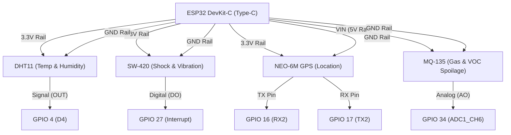

# AgriChain IoT Node: Breadboard Assembly & Wiring Guide

This guide walks you step-by-step through assembling and flashing your physical IoT cold-chain node using the exact components purchased from **Directronics Store** (Cash Invoice No. 5707, total **₹1,315.00 INR**).

---

## 1. Inventory & Hardware Audit


### Bill of Materials Reconciliation

| Item Code | Component | Delivered Hardware | Ingestion Pipeline Role | Notes & Pin Requirements |
|---|---|---|---|---|
| **DT0585** | ESP32 Dev Board | ESP32-WROOM-32 (Type-C USB, 30-pin) | Master Edge Microcontroller | Hardware SHA-256 accelerator, dual-core, Wi-Fi |
| **DT0016** | DHT11 Module | Blue 3-Pin Sensor Breakout | Temperature & Relative Humidity | Built-in pull-up resistor. Firmware set to `DHT11` |
| **DT0029** | MQ-135 Gas Sensor | 4-Pin Metal-Mesh Chemiresistor | Biochemical Volatiles (Ethylene, Rot) | Requires **5V (VIN)** for heater; AO to ADC1 (GPIO 34) |
| **DT0008** | NEO-6M GPS Module | GY-GPS6MV2 + Ceramic Patch Antenna | Cold-Chain Transit Geolocation | Hardware UART2 (`GPIO 16` RX / `GPIO 17` TX) |
| **DT0076** | SW-420 Sensor | Blue Module with LM393 & Trimpot | Transit Shock / Vibration Interrupt | Connected to `GPIO 27` hardware interrupt |
| **DT0151** | Breadboard | GL-12 840 Points Solderless | Prototyping Platform | Central divider isolates ESP32 dual pin banks |
| **—** | Jumpers | 10 M-M + 10 F-F Jumper Wires | Interconnections | Used for breadboard routing |
| **DT0066** | TP4056 Module | Type-C 1A Li-Ion Charger with Protection | Battery Power Subsystem | Phase 2 standalone crate power |
| **DT0098** | MT3608 Module | 2A Step-Up DC-DC Boost Converter | 3.7V to 5.0V Boost | Phase 2 standalone crate power |
| **—** | 18650 Cell | INR18650 3.7V 1200mAh (4.44Wh) | Portable Transit Power Source | Phase 2 standalone crate power |

> [!TIP]
> **Total Project Cost: ₹1,315.00 INR** (Well under the ₹3,000 budget cap — saving ₹850.94 compared to the online estimate!).
>
> **Phase 1 Prototyping Strategy (Zero Soldering Required)**:
> For initial breadboard testing, telemetry ingestion, and smart contract anchoring, power the ESP32 directly via your **USB Type-C cable** from your computer. The onboard 3.3V regulator powers the ESP32, DHT11, SW-420, and GPS, while the `VIN` pin passes through 5V from USB to power the MQ-135 heater coil. The 18650 battery + TP4056 + MT3608 booster can be wired later for standalone transit crate deployment.

---

## 2. Complete Breadboard Pin Connection Map



### Pin-by-Pin Wiring Table

| Peripheral | Sensor Pin Label | Connect To ESP32 Pin | Breadboard Rail | Wire Type | Purpose |
|---|---|---|---|---|---|
| **DHT11** | `+` (VCC) | `3V3` | Red (+) Rail | M-M / F-M | 3.3V Power |
| **DHT11** | `-` (GND) | `GND` | Blue (-) Rail | M-M / F-M | Ground |
| **DHT11** | `OUT` / `S` | `GPIO 4` (D4) | Breadboard Row | M-M / F-M | Single-Wire Temperature & Humidity Data |
| **MQ-135** | `VCC` | `VIN` (5V from USB) | 5V Power Rail | M-M / F-M | Powers internal $R_H$ heating coil |
| **MQ-135** | `GND` | `GND` | Blue (-) Rail | M-M / F-M | Ground |
| **MQ-135** | `AO` (Analog Out) | `GPIO 34` (D34) | Breadboard Row | M-M / F-M | 12-bit ADC VOC analog voltage |
| **MQ-135** | `DO` (Digital Out) | *Leave Unconnected* | — | — | Digital comparator output unused |
| **SW-420** | `VCC` | `3V3` | Red (+) Rail | M-M / F-M | 3.3V Power |
| **SW-420** | `GND` | `GND` | Blue (-) Rail | M-M / F-M | Ground |
| **SW-420** | `DO` (Digital Out) | `GPIO 27` (D27) | Breadboard Row | M-M / F-M | Hardware interrupt on physical shock |
| **NEO-6M GPS** | `VCC` | `3V3` (or VIN) | Red (+) Rail | M-M / F-M | 3.3V GPS receiver power |
| **NEO-6M GPS** | `GND` | `GND` | Blue (-) Rail | M-M / F-M | Ground |
| **NEO-6M GPS** | `TX` (Module Transmit) | `GPIO 16` (RX2) | Breadboard Row | M-M / F-M | NMEA 9600 baud GPS stream into ESP32 |
| **NEO-6M GPS** | `RX` (Module Receive) | `GPIO 17` (TX2) | Breadboard Row | M-M / F-M | Configuration commands to GPS |

> [!IMPORTANT]
> **ADC Pin Rule**: MQ-135 analog output **must strictly connect to GPIO 34** (ADC1). Never connect analog sensors to ADC2 pins (GPIO 0, 2, 4, 12-15, 25-27) while Wi-Fi is active, as the ESP32 Wi-Fi driver monopolizes ADC2.

---

## 3. Step-by-Step Assembly Instructions

### Step 1: Seat the ESP32 on the Breadboard
1. Align the ESP32 board over the central divider (trough) of the 840-point breadboard so the left and right rows of pins plug into separate sides of the trough.
2. Push down gently until all header pins are firmly seated into the breadboard contacts.

### Step 2: Establish Power and Ground Rails
1. Run a jumper wire from the ESP32 **`3V3` pin** to the red `(+)` power rail along the edge of the breadboard.
2. Run a jumper wire from any ESP32 **`GND` pin** to the blue `(-)` ground rail along the edge of the breadboard.
3. *Note on 5V for MQ-135*: Run a jumper wire directly from the ESP32 **`VIN` pin** (which outputs ~5V from the USB Type-C port) to the `VCC` pin of the MQ-135.

### Step 3: Wire the DHT11 (Temperature & Humidity)
1. Mount the DHT11 3-pin module onto an open section of the breadboard (or connect via F-M jumper wires).
2. Connect `+` to the `3V3` rail.
3. Connect `-` to the `GND` rail.
4. Connect `OUT` (or `S`) to ESP32 **`GPIO 4`** (marked `D4` or `4` on the silkscreen).

### Step 4: Wire the MQ-135 (Gas & Organic Spoilage)
1. Connect `VCC` to the ESP32 **`VIN` (5V)** pin.
2. Connect `GND` to the `GND` rail.
3. Connect `AO` to ESP32 **`GPIO 34`** (marked `D34` or `34`).
4. *Expected Behavior*: After 1–2 minutes of power, the silver mesh will feel warm. This is normal and required for the internal tin-dioxide ($SnO_2$) sensor heater.

### Step 5: Wire the SW-420 (Vibration & Mechanical Shock)
1. Connect `VCC` to the `3V3` rail.
2. Connect `GND` to the `GND` rail.
3. Connect `DO` to ESP32 **`GPIO 27`** (marked `D27` or `27`).
4. *Sensitivity Tuning*: Gently tap the breadboard. If the onboard LED on the SW-420 does not flash, or stays constantly on, use a small flat-head screwdriver to turn the blue potentiometer until the LED turns on only when tapped.

### Step 6: Connect the NEO-6M GPS & Antenna
1. Ensure the square beige ceramic patch antenna is snapped into the gold connector on the GPS module.
2. Connect `VCC` to the `3V3` rail.
3. Connect `GND` to the `GND` rail.
4. Connect `TX` to ESP32 **`GPIO 16`** (`RX2`).
5. Connect `RX` to ESP32 **`GPIO 17`** (`TX2`).
6. *Indoors Satellite Note*: If you are indoors away from a window, satellite lock may take several minutes (indicated by the small red LED blinking once per second). The firmware automatically uses Nashik agricultural hub coordinates (`19.9975, 73.7898`) as an instant fallback so your telemetry transmission never stalls!

---

## 4. Software Configuration & Flashing

The firmware is located in [`hardware/esp32_firmware/src/main.cpp`](file:///home/suyash/Projects/agri-chain/hardware/esp32_firmware/src/main.cpp).

### Configure Your Wi-Fi & Backend Endpoint
Open `hardware/esp32_firmware/src/main.cpp` and update lines 38–40:

```cpp
// Enter your home Wi-Fi or mobile hotspot credentials:
const char* WIFI_SSID     = "Your_WiFi_Or_Hotspot_Name";
const char* WIFI_PASSWORD = "Your_WiFi_Password";

// Your computer's local IP address running the AgriChain backend:
const char* FASTAPI_URL   = "http://192.168.1.103:8000/telemetry";
```

### Flashing via PlatformIO (Recommended)
If using VS Code with the PlatformIO extension:
1. Connect the ESP32 to your PC using the USB Type-C cable.
2. Open the folder `hardware/esp32_firmware/` in VS Code.
3. Click the **Build** (✓) button on the PlatformIO bottom toolbar.
4. Click the **Upload** (➔) button.
5. Click the **Serial Monitor** (plug) icon set to baud rate `115200`.

### Flashing via Arduino IDE (Alternative)
1. In Arduino IDE, go to **Tools → Board → ESP32 Arduino → ESP32 Dev Module**.
2. Install required libraries from Library Manager:
   - `ArduinoJson` (v7.x)
   - `DHT sensor library` (Adafruit)
   - `TinyGPSPlus` (Mikal Hart)
3. Open `hardware/esp32_firmware/src/main.cpp`.
4. Select your USB port under **Tools → Port** (e.g. `/dev/ttyUSB0` or `COM3`).
5. Click **Upload**.

---

## 5. Live Telemetry Verification Flow

Once flashed, the ESP32 will output the following to the Serial Monitor every 10 seconds:

```text
[TELEMETRY] Generated: {"batch_id":"BAT-TOM-802","temp_c":24.0,"humidity_pct":65.0,"lat":19.9975,"lon":73.7898,"timestamp":"2026-10-29T14:45:39Z","nonce":1041,"freshness_voc_ppm":12.4,"tamper_status":"SEALED"}
[HTTP] POST 200 OK | SHA256: d12195ecab5526005fb4b99ab744c7425ba24f32f3be111a20c63c9c2da64638
```

You can view the real-time readings anchoring on the AgriChain UI:
1. **Farmer Dashboard / Crop Tracking**: `http://localhost:3000/`
2. **Logistics Portal (Safexpress)**: Shows vehicle telemetry stream, GPS coordinates, and temperature stability.
3. **Admin Blockchain Explorer**: Shows on-chain transactions generated by the AI Trust Layer.
