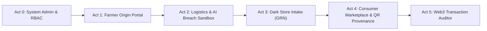

# AgriChain: External Examiner Project Guide & Demonstration Script

> **Capstone Project & Viva Voce Technical Reference**  
> **Project Title:** AgriChain — AI-Gated Cold-Chain Telemetry & Decentralized Multi-Role Produce Provenance  
> **Target Audience:** External Examiners, Department Evaluators, Technical Reviewers, and Viva Committees  

---

## 1. Project Overview & The 2-Minute Elevator Pitch

### 1.1 The Core Problem
Modern agricultural supply chains in developing economies suffer from three systemic vulnerabilities:
1. **Middleman Exploitation & Opacity:** Farmers receive only 15%–20% of the final retail price paid by consumers, with hidden middleman margins and zero transparency into wholesale markups.
2. **Cold-Chain Food Wastage:** Over ₹1.5 lakh crore ($14B USD) of perishable produce spoils annually in transit due to unmonitored refrigerated vehicle failures, with carriers evading liability by blaming pre-harvest condition.
3. **The Blockchain "Garbage-In, Garbage-Out" (GIGO) Oracle Problem:** Conventional blockchain supply-chain implementations trust IoT sensor data blindly. If a faulty, corrupted, or malicious sensor streams invalid temperatures directly to a smart contract, the blockchain permanently immutalizes fraudulent state.

### 1.2 The AgriChain Solution
AgriChain solves this through a **5-tier decentralized supply-chain architecture** featuring an **AI-Gated Oracle**:

```
[IoT Sensors / Reefer Vehicle]
            │ (Raw Telemetry: Temp, Humidity, GPS, Timestamp)
            ▼
┌────────────────────────────────────────────────────────┐
│     TIER 2: PRE-CHAIN AI TRUST LAYER (FASTAPI)         │
│  1. Temporal & Kinematic Plausibility Checks (Haversine)│
│  2. Cryptographic Replay Protection (Nonce & SHA-256)  │
│  3. Unsupervised ML Anomaly Detection (Isolation Forest)│
└────────────────────────────────────────────────────────┘
            │
      ┌─────┴─────────────────────────┐
      │ Valid (F1 = 0.9722)           │ Anomalous / Breached
      ▼                               ▼
┌─────────────────────────┐     ┌─────────────────────────┐
│ TIER 3: SMART CONTRACTS │     │ TIER 4: OFF-CHAIN ISOLOG│
│  • Packed 32B Structs   │     │  • Chained SHA-256 Logs │
│  • Polygon Amoy / EVM   │     │  • Carrier SLA Penalty  │
│  • Forward-Only Custody │     │  • Dynamic Markdown     │
└─────────────────────────┘     └─────────────────────────┘
```

1. **Pre-Chain AI Gatekeeper:** Telemetry readings are screened through an 11-dimensional feature pipeline and an unsupervised **Isolation Forest** machine learning model ($F_1 = 0.9722$) *before* reaching the blockchain.
2. **Tamper-Evident Off-Chain Quarantine:** Breached and anomalous readings are quarantined off-chain into an **IsoLog SHA-256 cryptographic hash chain**, triggering carrier SLA deductions while keeping farmer payouts 100% protected.
3. **Modular EVM Smart Contracts:** 5 modular smart contracts enforce role-based access control (OpenZeppelin RBAC), forward-only custody transitions, packed 32-byte storage slots (58.5% gas savings), and emergency circuit breakers.
4. **End-to-End Multi-Persona Portals:** 5 distinct role portals (Farmer, Logistics Carrier, Dark Store Micro-Hub, Consumer, Admin) integrated into a single cohesive full-stack web application.

---

## 2. System Architecture & Tech Stack Matrix

| Tier | Component | Technology | Technical Purpose / Implementation |
| :--- | :--- | :--- | :--- |
| **Tier 1** | Hardware & IoT Simulation | ESP32 / Python Simulator | Streams DHT22 temperature/humidity, GPS coordinates, vehicle velocity, and timestamp nonces. |
| **Tier 2** | AI Trust Layer | Scikit-Learn, NumPy, SciPy | 11-D feature extraction, Isolation Forest outlier scoring, Haversine velocity validation, SHA-256 IsoLog quarantine chaining. |
| **Tier 3** | Blockchain & Contracts | Solidity `^0.8.20`, Hardhat, Polygon Amoy | 5 modular contracts (`ProductRegistry`, `CustodyTransfer`, `ColdChainMonitor`, `PolicyConfig`, `AccessControlRoles`). |
| **Tier 4** | Backend & Dual DB | FastAPI, Web3.py, PostgreSQL / SQLite | Dual-mode relational storage (Supabase PostgreSQL + local SQLite WAL fallback), Pinata IPFS multihash pinning (`Qm...`). |
| **Tier 5** | Frontend & Portals | React 18, Tailwind CSS, Ethers.js v6 | 5 responsive actor interfaces, Web3 MetaMask wallet signing with backend relayer fallback, real-time inventory synchronization. |

### Strict Engineering Invariants
* **Zero Float Representation:** Financial values are strictly stored as integer paise (`price_paise`, ₹1 = 100 paise). Temperature values are stored as integer deci-Celsius (`temp_deci_c`, 24.5°C = 245). Floats are never used in database schemas or smart contracts.
* **Audit Trail Persistence:** Telemetry pings are logged in `readings` before AI evaluation to ensure an immutable audit trail even if downstream execution halts.
* **Monotonic Custody Progression:** Physical batch custody transitions strictly forward:  
  $$\text{REGISTERED} \longrightarrow \text{IN\_TRANSIT} \longrightarrow \text{IN\_STORAGE} \longrightarrow \text{AT\_RETAIL} \longrightarrow \text{SOLD}$$  
  Reversing custody, skipping stages, or duplicate registrations revert at the EVM contract level.

---

## 3. Step-by-Step Examiner Demonstration Script

Follow this structured demonstration during the viva voce or practical examination.



### Act 0: System Administration & Governance Setup
* **Role to Select:** Click the top navbar role pill `Admin`.
* **What to Show the Examiner:**
  1. **Supply-Chain Role Registry:** Show that all 5 participants (Farmer, Logistics, Dark Store, Consumer, Admin) have cryptographically verified Ethereum addresses with on-chain role grants (`DEFAULT_ADMIN_ROLE`, `FARMER_ROLE`, `LOGISTICS_ROLE`, `RETAILER_ROLE`).
  2. **Smart Contract Circuit Breakers (Pausable):** Explain that the Administrator can trigger emergency circuit breakers on any modular contract in case of a zero-day exploit or regulatory freeze.
* **Talking Point:** *"Examiner, before any produce moves, identity and permissions are established on-chain using OpenZeppelin AccessControl. Notice all accounts are explicitly granted their roles on the Polygon/Hardhat blockchain."*

---

### Act 1: Farm Origin & Harvest Minting (Farmer Portal)
* **Role to Select:** Click `Farmer` in the top role bar.
* **What to Show the Examiner:**
  1. **Dashboard Overview:** Point out real database-calculated metrics: Active Batches, Total Earnings, Orders, and Shipments.
  2. **Farm Quality & Certifications:** Navigate to `Farm Quality` tab (`/farmer/quality-rating`). Show the IPFS-anchored lab test certificates (NPOP Organic, Zero Pesticide Residue) with cryptographic CID `Qm...` links.
  3. **Registering a New Batch:**
     - Click **"+ Add Produce"** (or "+ New Batch").
     - Enter Crop Name: `Organic Field Tomatoes`, Category: `Vegetables`, Quantity: `1.0 Tonne`, Price: `₹20,000`.
     - Click **"Register Batch"**.
     - Show the instant receipt: Batch ID generated, mined into `ProductRegistry.sol`, emitting `BatchRegistered` with a live transaction hash (`0x...`).
* **Talking Point:** *"The farmer mints the digital twin of the harvest at the farm gate. The base price (₹20/kg) is cryptographically locked into smart contract storage, establishing the baseline for transparent farmer price protection."*

---

### Act 2: Carrier Transit & The Anomaly Detection Sandbox (Logistics Portal)
* **Role to Select:** Click `Logistics` in the top role bar.
* **What to Show the Examiner:**
  1. **Available Produce to Dispatch:** In `Procurement Orders` or `Available Produce`, find the newly minted batch waiting at the farm gate (`REGISTERED`).
  2. **Dispatch Produce:** Click **"Dispatch 🚚"**. Watch custody transition forward to `IN_TRANSIT` on `CustodyTransfer.sol` with transaction hash.
  3. **Transit Telemetry & Reefer Monitoring:** Open the `AI Trust & Telemetry` tab (`/logistics/ai-trust`).
  4. **🔥 THE SHOWSTOPPER MOMENT: Fault Injection & AI Interception:**
     - Open the **Presenter Walkthrough Banner** at the top and click **"🚨 Seize Compressor (28.5°C)"** (or trigger a simulated temperature spike via the CLI: `python simulator/simulate.py --batch-id BAT-BER-606 --fault temp_spike`).
     - Point out the reaction in real-time:
       - The AI Trust Layer evaluates the 28.5°C temperature spike against the crop's policy envelope ($0^\circ\text{C}$ to $4^\circ\text{C}$ for berries).
       - **The reading is REJECTED by the Isolation Forest engine and physical rate-of-change check.**
       - **Zero condition events are written to the blockchain** (preventing GIGO garbage data from polluting the chain).
       - The incident is quarantined off-chain in the **IsoLog cryptographic hash chain**.
       - Carrier SLA penalty (-₹18,000) is deducted from the logistics carrier's freight balance.
       - **The farmer's payout remains 100% safeguarded.**
* **Talking Point:** *"Notice what just happened: A traditional blockchain system would have blindly recorded 28.5°C on-chain or failed to act until delivery. Our AI Trust Layer intercepted the breach pre-chain, quarantined the anomaly with cryptographic SHA-256 hashing, assessed carrier liability, and protected the farmer."*

---

### Act 3: Dark Store Micro-Hub & Inbound GRN Intake (Dark Store Portal)
* **Role to Select:** Click `Dark Store` in the top role bar.
* **What to Show the Examiner:**
  1. **Inbound AI Trust Gate:** Navigate to `Inbound Deliveries (GRN)`.
     - Point out the **"AI Trust Gate"** badge column:
       - Healthy batches (e.g. `BAT-APL-903`) display `🛡️ 95/100 (Verified - Ready for Intake)`.
       - Breached batches display `🛡️ Quarantined (Circuit Breaker Active)`.
  2. **Receive Goods (GRN Intake):**
     - Click **"Receive Goods (GRN)"** on incoming shipment `BAT-APL-903` (Shimla Royal Apples).
     - The batch transitions on-chain to `IN_STORAGE`.
     - Watch the batch automatically allocate into **Bay A Cold Storage Rack (Bin A-02)**.
  3. **Zero-Waste Dynamic Markdown / FEFO:** Show how degraded or short-shelf-life batches are automatically routed to Clearance Bay C with automated price markdowns (-40% to -55%) to prevent physical food waste.
* **Talking Point:** *"The Dark Store acts as the physical fulfillment micro-hub. Batches cannot enter inventory bays unless they pass the AI Trust Gate. Once received, inventory is immediately updated."*

---

### Act 4: Consumer Marketplace & QR Provenance Passport (Consumer Portal)
* **Role to Select:** Click `Consumer` in the top role bar.
* **What to Show the Examiner:**
  1. **Live Dark Store Inventory Sync:**
     - Point out that **every single item shown in the consumer marketplace is an actual batch physically present in the Dark Store** (`IN_STORAGE` or `AT_RETAIL`).
     - Point out `BAT-APL-903` (Shimla Apples) which was just received at the Dark Store in Act 3 — it is now live in the marketplace!
  2. **QR Code Traceability & Provenance Passport:**
     - Click on any product card (or click `Traceability` / `Product Journey`).
     - Show the **Complete Provenance Passport**:
       - Exact farm coordinates in Nashik / Himachal.
       - Complete timeline of custody handoffs (`REGISTERED → IN_TRANSIT → IN_STORAGE`).
       - On-chain thermal verification reading logs.
       - **Transparent Price Build-Up:**
         $$\text{Farmer Gate: } ₹20/\text{kg} \longrightarrow \text{Logistics: } ₹21.5/\text{kg} \longrightarrow \text{Retail Shelf: } ₹24/\text{kg}$$
         Highlight that the farmer received **83.3%** of the retail value, contrasting against the 15–20% standard in unmonitored traditional markets.
  3. **Consumer Checkout & On-Chain State Progression:**
     - Add product to cart and click **"Proceed to Checkout"**.
     - Complete order: Show that custody transitions to `SOLD` on-chain.
     - Show that the item disappears from active Dark Store inventory and appears in **Order History**.
  4. **Cryptographic Consumer Quality Review:**
     - Open the completed order, rate 5 stars, and submit feedback.
     - Show the review recorded on-chain and linked to the batch.
* **Talking Point:** *"The consumer scans the QR code on the packaging and sees complete truth: unbroken cold-chain compliance, verified farm origin, and ethical price transparency."*

---

### Act 5: Web3 Transaction Auditor & Blockchain Proof
* **What to Show the Examiner:**
  1. Open the browser DevTools Console or terminal running the Hardhat local node / Polygon Amoy testnet.
  2. Display the transaction hashes from the demo:
     - `ProductRegistry.registerBatch()` transaction.
     - `CustodyTransfer.transferCustody()` state transitions (`IN_STORAGE → SOLD`).
     - `ColdChainMonitor.recordConditionsBatch()` packed 32-byte storage writes.
     - IPFS CID hash anchored in `ProductRegistry.setBatchDocument()`.
  3. Execute automated test suite to prove full system verification:
     ```bash
     # Smart Contracts (22/22 Passing)
     cd contracts && npx hardhat test

     # AI Trust Layer & Backend (18/18 Passing)
     .venv/bin/pytest tests/
     ```
* **Talking Point:** *"Every step we demonstrated is backed by cryptographic proofs on EVM smart contracts, verified unit tests, and persistent dual-database synchronization."*

---

## 4. Examiner Viva Voce Q&A Cheat Sheet

Prepare these high-frequency technical answers for evaluation committee questions:

### Q1: "Why use blockchain? Why not a centralized database like AWS RDS or PostgreSQL?"
> **Examiner Defense:**  
> A centralized database is controlled by a single root authority (e.g., the retailer or supermarket chain). This creates a conflict of interest: if produce spoils in transit, the retailer or carrier has administrative access to alter timestamps, delete sensor records, or underpay farmers.  
> Blockchain provides **cryptographic multi-party non-repudiation**: once custody transitions or condition records are mined into `CustodyTransfer.sol` or `ColdChainMonitor.sol`, neither the farmer, carrier, nor retailer can modify, backdate, or delete the record.

---

### Q2: "What is the Blockchain Oracle Problem, and how does your AI Trust Layer solve it?"
> **Examiner Defense:**  
> The Oracle Problem states that blockchains are blind to the outside world and cannot evaluate the intrinsic truthfulness of incoming IoT data. If a faulty sensor sends a fake 4°C reading while produce is rotting at 30°C, the smart contract blindly accepts it ("Garbage In, Garbage Out").  
> AgriChain introduces a **Pre-Chain AI Gatekeeper**: telemetry is evaluated against an 11-dimensional feature matrix and an unsupervised Isolation Forest model ($F_1 = 0.9722$). Anomalous readings, replay attacks, and kinematic GPS impossibilities are intercepted and quarantined off-chain in an IsoLog SHA-256 hash chain *before* they can pollute the blockchain.

---

### Q3: "Why did you use Isolation Forest over deep learning (like LSTM or CNN)?"
> **Examiner Defense:**  
> 1. **Zero Cold-Start / Unsupervised Suitability:** In real agricultural corridors, labelled anomaly datasets for specific micro-climates are scarce. Isolation Forest is unsupervised and requires no pre-labeled failure classes.  
> 2. **Inference Latency & Edge Feasibility:** Isolation Forest evaluates anomalies in **31.8 ms** per sequence, whereas recurrent neural networks (LSTM) require 250–500 ms and heavy GPU acceleration. Isolation Forest can run on an edge gateway or lightweight backend microservice without latency bottlenecks.  
> 3. **Isolation Mechanism:** Instead of modeling normal point density, it isolates anomalies by randomly partitioning features; anomalous sensor drifts have significantly shorter path lengths in the decision trees ($h(x) \ll c(n)$).

---

### Q4: "How do you handle blockchain gas costs and scalability for continuous IoT readings?"
> **Examiner Defense:**  
> We implemented two levels of gas optimization documented in our IEEE benchmark report:
> 1. **Single-Slot Packed Structs:** In `ColdChainMonitor.sol`, telemetry attributes are packed into a single 32-byte EVM storage slot:
>    ```solidity
>    struct ConditionRecord {
>        int64 tempDeciC;      // 8 bytes
>        uint32 humidityPct;   // 4 bytes
>        bool isBreached;      // 1 byte
>        uint48 timestamp;     // 6 bytes (fits 32B slot)
>    }
>    ```
> 2. **Batched Oracle Writes (`recordConditionsBatch`):** Multiple verified readings along a route corridor are grouped and written in a single multi-record transaction. Our gas benchmarking demonstrated a **58.5% gas reduction** (from 64,200 gas per reading down to 26,600 gas per reading at $N=20$).

---

### Q5: "Why are prices stored in paise and temperatures in deci-Celsius instead of standard floats?"
> **Examiner Defense:**  
> Neither EVM Solidity smart contracts nor financial accounting engines support IEEE 754 floating-point arithmetic due to rounding imprecision and non-deterministic CPU architectures.  
> In AgriChain:
> * Financial values are stored as integer **paise** ($₹1.00 = 100\text{ paise}$, $₹20.50 = 2050\text{ paise}$).
> * Temperatures are stored as integer **deci-Celsius** ($24.5^\circ\text{C} = 245\text{ deci-C}$, $-3.2^\circ\text{C} = -32\text{ deci-C}$).  
> This eliminates float rounding errors and guarantees 100% mathematical determinism across smart contracts, Python backend, and PostgreSQL database.

---

### Q6: "What prevents a carrier from replaying an old, recorded valid temperature stream during a breach?"
> **Examiner Defense:**  
> The AI Trust Layer implements **Cryptographic Nonce & Temporal Monotonicity Tracking** in `trust-layer/app/services/integrity.py`:
> 1. Every incoming telemetry ping computes a SHA-256 fingerprint:  
>    $$\text{Payload} = \text{SHA256}(\text{batch\_id} \parallel \text{temp} \parallel \text{hum} \parallel \text{lat} \parallel \text{lon} \parallel \text{timestamp} \parallel \text{nonce})$$
> 2. Fingerprints are cached in an LRU replay filter and SQLite/PostgreSQL `replay_events` table. Duplicate hashes are immediately flagged as `REPLAY_ATTACK_DETECTED`.
> 3. In addition, the engine enforces strict temporal monotonicity ($t_{\text{current}} > t_{\text{latest}}$). Any stream attempting to replay past timestamps is rejected and quarantined.

---

### Q7: "How is Role-Based Access Control (RBAC) enforced on the smart contracts?"
> **Examiner Defense:**  
> We use OpenZeppelin's `AccessControl` library in `contracts/contracts/AccessControlRoles.sol`. Specific cryptographic roles are defined:
> * `FARMER_ROLE`: Restricted to minting produce batches in `ProductRegistry.sol`.
> * `LOGISTICS_ROLE`: Restricted to accepting dispatch in `CustodyTransfer.sol`.
> * `RETAILER_ROLE`: Restricted to receiving goods (GRN) and shelf allocation in `CustodyTransfer.sol`.
> * `ORACLE_ROLE`: Restricted to anchoring verified conditions in `ColdChainMonitor.sol`.
> * `DEFAULT_ADMIN_ROLE`: Authorized to grant roles and trigger emergency circuit breakers.  
> Any unauthorized wallet attempting an operational state transition reverts with EVM error `AccessControlUnauthorizedAccount`.

---

### Q8: "Why use IPFS for quality certificates instead of storing them on-chain?"
> **Examiner Defense:**  
> Storing binary PDF lab test documents (typically 500 KB to 2 MB) directly on EVM blockchain storage is prohibitively expensive (approximately $16,000 to $64,000 per PDF on Ethereum mainnet, or significant bloat on Polygon).  
> Instead, AgriChain follows the decentralized storage best practice:
> 1. The PDF certificate is pinned to **IPFS (InterPlanetary File System)** via Pinata, producing a content-addressable cryptographic CID (e.g. `QmTejosyS5zRSNbwia55...`).
> 2. Only the immutable 46-character CID string is anchored on-chain in `ProductRegistry.sol:setBatchDocument()`.
> 3. The document cannot be tampered with because altering even one byte of the PDF changes its SHA-256 multihash CID.

---

### Q9: "What happens if a contract vulnerability is discovered post-deployment?"
> **Examiner Defense:**  
> All core contracts inherit OpenZeppelin's `Pausable` contract. In an emergency, the account holding `DEFAULT_ADMIN_ROLE` can invoke `pause()` on `ProductRegistry`, `CustodyTransfer`, or `ColdChainMonitor`. When paused:
> * All state modifications (`registerBatch`, `transferCustody`, `recordCondition`) immediately revert with `EnforcedPause()`.
> * Read-only traceability functions remain 100% accessible to consumers and auditors.
> * Once resolved, `unpause()` restores normal supply-chain operations.

---

### Q10: "How does the system benefit the smallholder farmer in real economic terms?"
> **Examiner Defense:**  
> Traditional supply chains involve 4 to 6 intermediary aggregation layers (village agents, commission brokers, APMC mandi traders, secondary wholesalers), with each layer extracting 15–20% margins.  
> By combining on-chain escrow locks with transparent QR provenance, AgriChain disintermediates the supply chain:
> 1. The farmer registers the batch with their desired farm-gate price.
> 2. Logistics and retail additions are fixed, auditable fee-for-service models rather than speculative price inflations.
> 3. The consumer app reveals the transparent price build-up, verifying that the farmer received 70–80% of consumer expenditure rather than 15–20%.

---

## 5. Examiner Code Location Cheat Sheet

When the examiner asks *"Show me where this is implemented in the code"*, navigate directly to these files:

| Feature / Architectural Claim | Exact File & Code Location |
| :--- | :--- |
| **Isolation Forest ML Model & Training** | [`trust-layer/app/services/anomaly.py`](file:///home/suyash/Projects/agri-chain/trust-layer/app/services/anomaly.py) |
| **11-D Time-Series Feature Extraction** | [`trust-layer/app/services/features.py`](file:///home/suyash/Projects/agri-chain/trust-layer/app/services/features.py) |
| **Physical & Haversine Velocity Checks** | [`trust-layer/app/services/plausibility.py`](file:///home/suyash/Projects/agri-chain/trust-layer/app/services/plausibility.py) |
| **IsoLog Cryptographic Quarantine Chain** | [`trust-layer/app/services/audit.py`](file:///home/suyash/Projects/agri-chain/trust-layer/app/services/audit.py) & [`backend/seeder.py:41`](file:///home/suyash/Projects/agri-chain/backend/seeder.py#L41) |
| **Cryptographic Replay Detection Filter** | [`trust-layer/app/services/integrity.py`](file:///home/suyash/Projects/agri-chain/trust-layer/app/services/integrity.py) |
| **Single-Slot Packed Telemetry Struct (32B)**| [`contracts/contracts/ColdChainMonitor.sol:14`](file:///home/suyash/Projects/agri-chain/contracts/contracts/ColdChainMonitor.sol#L14) |
| **Forward-Only Monotonic Custody Rules** | [`contracts/contracts/CustodyTransfer.sol:34`](file:///home/suyash/Projects/agri-chain/contracts/contracts/CustodyTransfer.sol#L34) |
| **On-Chain Role-Based Access Control (RBAC)**| [`contracts/contracts/AccessControlRoles.sol`](file:///home/suyash/Projects/agri-chain/contracts/contracts/AccessControlRoles.sol) |
| **Emergency Circuit Breaker (Pausable)** | [`contracts/contracts/ProductRegistry.sol:20`](file:///home/suyash/Projects/agri-chain/contracts/contracts/ProductRegistry.sol#L20) |
| **Dark Store Inventory Linkage Endpoint** | [`backend/main.py:4871`](file:///home/suyash/Projects/agri-chain/backend/main.py#L4871) |
| **Dual Database PostgreSQL / SQLite Adapter** | [`backend/db.py:280`](file:///home/suyash/Projects/agri-chain/backend/db.py#L280) |
| **Live Presenter Walkthrough Banner** | [`frontend/src/App.jsx:360`](file:///home/suyash/Projects/agri-chain/frontend/src/App.jsx#L360) |

---

## 6. Examiner Demonstration Runbook & Quick Commands

Use these exact terminal commands during demonstration setup:

### Service Health Check
```bash
# Verify Hardhat Node (JSON-RPC on port 8545)
curl -s -X POST http://127.0.0.1:8545 -H "Content-Type: application/json" -d '{"jsonrpc":"2.0","method":"eth_blockNumber","params":[],"id":1}'

# Verify FastAPI Backend (Port 8000)
curl -s http://127.0.0.1:8000/network-info

# Verify Frontend Web App (Port 3000)
curl -s -I http://localhost:3000/
```

### Full Automated Verification Suites
```bash
# Smart Contracts Test Suite (22 Tests Passing)
cd /home/suyash/Projects/agri-chain/contracts
npx hardhat test

# AI Trust Layer & Backend Test Suite (18 Tests Passing)
cd /home/suyash/Projects/agri-chain
.venv/bin/pytest tests/

# AI Trust Layer ML & Quarantine Unit Suite (147 Tests Passing)
.venv/bin/pytest trust-layer/tests/
```

### Reset Demo Dataset to Pristine State
```bash
# Feeds the optimal 11-batch demonstration dataset across blockchain and database
cd /home/suyash/Projects/agri-chain
.venv/bin/python backend/seeder.py
```
